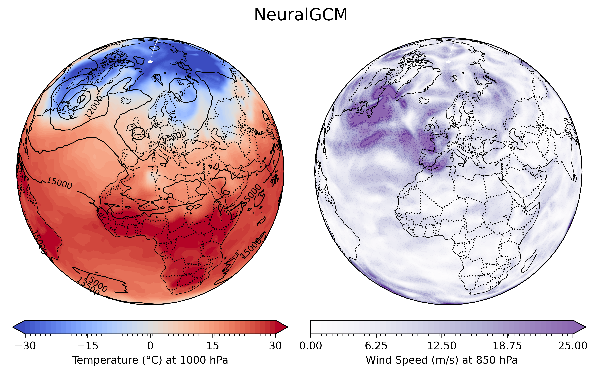
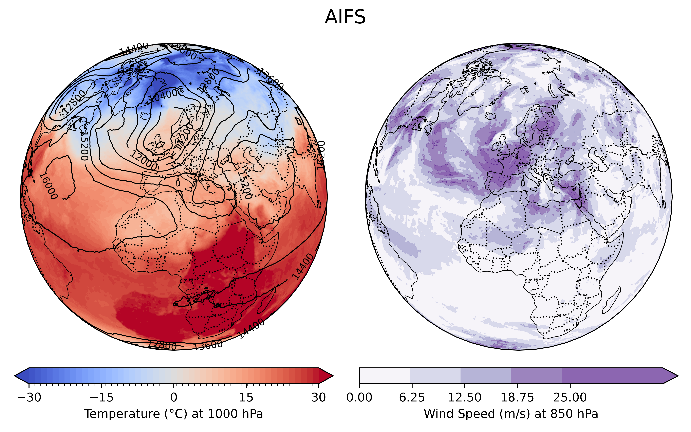

# AIUQ

> **v0.2.0**
> NEW: AMIP simulations now supported. 
> Currently, forcings prescribed in the [AIMIP project](https://zenodo.org/records/17065758) and from [ESA-CCI-v3.0](https://climate.esa.int/en/projects/sea-surface-temperature/) are available. Future releases will allow a full customization of the experiment. 

AIUQ (Artificial Intelligence weather forecasting models for Uncertainty Quantification) is a framework for running AI-based weather and climate models using Autosubmit. It is designed to efficiently handle different combinations of initial conditions (ICs) and models. The integration of multiple fallback methods allows the use of different sets of initial conditions, even when they do not fully match the AI model requirements.


The framework supports both deterministic and stochastic models. Deterministic models always produce the same results when initialized with the same ICs, whereas stochastic models are able to generate an ensemble of realizations starting from identical ICs. For this reason, AIUQ also implements several classes of methods to perturb the ICs (still under development), allowing the generation of ensembles of realizations even from deterministic models.

<table><tr><td>
<b>The current implementation supports the following ICs / AI models:</b><br><br>
<table>
<tr>
<th>Model</th>
<th>Supported modes</th>
<th>Checkpoint</th>
<th>ERA5</th>
<th>EERIE (AMIP)</th>
</tr>
<tr>
<td rowspan="6"><b>NeuralGCM</b></td>
<td rowspan="6">amip/hindcast</td>
<td><a href="https://neuralgcm.readthedocs.io/en/latest/checkpoints.html">stochastic_1_4_deg.pkl</a></td>
<td align="center">✅</td>
<td align="center">✅</td>
</tr>
<tr>
<td><a href="https://neuralgcm.readthedocs.io/en/latest/checkpoints.html">stochastic_precip_2_8_deg.pkl</a></td>
<td align="center">✅</td>
<td align="center">✅</td>
</tr>
<tr>
<td><a href="https://neuralgcm.readthedocs.io/en/latest/checkpoints.html">stochastic_evap_2_8_deg.pkl</a></td>
<td align="center">✅</td>
<td align="center">✅</td>
</tr>
<tr>
<td><a href="https://neuralgcm.readthedocs.io/en/latest/checkpoints.html">deterministic_0_7_deg.pkl</a></td>
<td align="center">✅</td>
<td align="center">✅</td>
</tr>
<tr>
<td><a href="https://neuralgcm.readthedocs.io/en/latest/checkpoints.html">deterministic_1_4_deg.pkl</a></td>
<td align="center">✅</td>
<td align="center">✅</td>
</tr>
<tr>
<td><a href="https://neuralgcm.readthedocs.io/en/latest/checkpoints.html">deterministic_2_8_deg.pkl</a></td>
<td align="center">✅</td>
<td align="center">✅</td>
</tr>
<tr>
<td rowspan="2"><b>AIFS</b></td>
<td rowspan="2">hindcast</td>
<td><a href="https://huggingface.co/ecmwf/aifs-single-1.1">aifs-single-mse-1.1.ckpt</a></td>
<td align="center">✅</td>
<td align="center">⚠️</td>
</tr>
<tr>
<td><a href="https://huggingface.co/ecmwf/aifs-ens-1.0">aifs-ens-crps-1.0.ckpt</a></td>
<td align="center">✅</td>
<td align="center">✅</td>
</tr>
<tr>
<td rowspan="4"><b>MS Aurora</b></td>
<td rowspan="4">hindcast</td>
<td><a href="https://microsoft.github.io/aurora/models.html">aurora-0.25-pretrained.ckpt</a></td>
<td align="center">✅</td>
<td align="center">⚠️</td>
</tr>
<tr>
<td><a href="https://microsoft.github.io/aurora/models.html">aurora-0.25-finetuned.ckpt</a></td>
<td align="center">⚠️</td>
<td align="center">⚠️</td>
</tr>
<tr>
<td><a href="https://microsoft.github.io/aurora/example_v1p5.html">aurora-0.25-v1.5.ckpt</a></td>
<td align="center">⚠️</td>
<td align="center">⚠️</td>
</tr>
<tr>
<td><a href="https://microsoft.github.io/aurora/models.html#aurora-1-5-ensemble-0-25">aurora-0.25-v1.5-ensemble.ckpt</a></td>
<td align="center">✅</td>
<td align="center">⚠️</td>
</tr>
<tr>
<td rowspan="1"><b>ACE</b></td>
<td rowspan="1">amip</td>
<td><a href="https://huggingface.co/allenai/ACE2-ERA5">ACE2-ERA5</a></td>
<td align="center">⚠️</td>
<td align="center">❌</td>
</tr>
</table>
</td>
<td style="padding-left:20px; vertical-align:top;">
<b> </b><br><br>
<b> </b><br><br>
✅ available<br>
⚠️ work in progress<br>
❌ not implemented<br>
</td></tr></table>


<p align="center">
  
  
  <br>
  <em>
  NeuralGCM (resolution 1.4°) and AIFS-ens (resolution 0.25°) forecasts for January 21st, 1988.
  Both simulations are initialized on January 1st, 1988, using ERA5 reanalysis data.
  </em>
</p>

## Quickstart

### Installation

To run the framework you need
- Autosubmit in your local machine. Please refer to the [official documentation](https://autosubmit.readthedocs.io/en/master/) to install it.
- The supporting files on your HPC

**Important**: The supporting files must be stored in a folder (from now on <supporting_folder>) which path you will be ask to provide for the execution of the framework.

The supporting files are the following:
```
<supporting_folder>
└── AIUQ  
      ├── models        # Contains the checkpoint for the inference
      ├── sif           # Contains the images for running the scripts
      ├── static        # Contains static (i.e. orography) data for 1st level fallback
      ├── climatology   # Contains climatological data used for 2nd level fallback
      └── amip-forcings # Contains forcings for AMIP simulations
```

*Section still in development*

### Execution

#### Create the experiment
```
autosubmit expid \
  --description "AIUQ" \
  --HPC MareNostrum5ACC \
  --minimal_configuration \
  --git_as_conf conf/bootstrap/ \
  --git_repo https://gitlab.earth.bsc.es/ces/AIUQ.git \
  --git_branch main
```

MareNostrum5ACC

#### Run the experiment

Create the file <EXPID>/conf/main.yml. 

```
# <EXPID>/conf/main.yml

MODEL:
  # Main settings
  NAME: aifs                                        # aifs / neuralgcm / ms-aurora
  CHECKPOINT_NAME: aifs-single-mse-1.1.ckpt         # checkpoint name as written in the table above
  ICS: eerie                                        # eerie / era5

EXPERIMENT:
  RUN_TYPE: "hindcast" # hincast/amip
  MEMBERS: "1 2"
  CHUNKSIZEUNIT: day
  DATELIST: 20100101
  CHUNKSIZE: 2
  NUMCHUNKS: 1
  CALENDAR: standard
  OUT_VARS:       
    - t                                                         # Make sure to use the name provided in the standard
  OUT_FREQ: daily                                               # original / daily
  OUT_RES: "1"                                                  # original / 0.25 / 0.5 / 1 / 1.5 / 2
  OUT_LEVS: [1000, 850, 700, 500, 250, 100, 50, 10]             # List of values in hPa or 'original' - 
  # Here reported from https://github.com/PCMDI/cmip6-cmor-tables/blob/087fe45d21c082e28723e0f930e4266abe91b853/Tables/CMIP6_coordinate.json#L1640

  FORCING_VERSION: ESA-CCI-v3.0   # ESA-CCI-v3.0/AIMIP

PATHS:
  SUPPORT_FOLDER: /gpfs/scratch/ehpc536/AIUQ
  SIF_FOLDER: "%PATHS.SUPPORT_FOLDER%/sif"

PLATFORM:
  NAME: MARENOSTRUM5  # FELIPE / MARENOSTRUM5
  USER_CODE: #write your HPC user here
```

Note that some ICs requires credential to be retrieved. 
- ERA5  -> Google Cloud Store - No credentials required
- EERIE -> MARS - ECMWF Web API credentials required ([read here](https://www.ecmwf.int/en/computing/software/ecmwf-web-api))

## Developer’s Guide

### Standard

The main challenge in developing and maintaining the framework is handling the different specifications required by each IC and AI model, such as naming conventions, grids, pressure levels, etc. Hardcoding every possible combination quickly leads to an unmanageable number of cases.

To address this issue, the framework adopts a standard convention called **AIUQ-st**:

- ICs are always saved, retrieved, and temporarily restored according to the AIUQ-st standard.
- AI models always perform inference starting from data formatted in the AIUQ-st standard.

Since this standard may evolve due to future developments or different user requirements, it is versioned. Each version is stored under `docs/AIUQ-st/version`.

**Note:** Developers are responsible for keeping the codebase as modular as possible in order to remain independent of any single AIUQ-st convention.

#### Forecast NetCDF output (schema 1.0)

All three model runners use `runscripts/AIUQst_lib/output.py` for their final
forecast format. This output schema is versioned separately from the AIUQ-st
variable/IC definitions. Input Zarr files keep their existing 0–360° longitude
convention; final NetCDF forecasts use:

| Coordinate | Meaning |
| --- | --- |
| `latitude` | Degrees north, increasing south to north |
| `longitude` | Degrees east in **[-180, 180)**, increasing; 180° is represented by -180° |
| `time` | Scalar UTC forecast initialization, taken from the actual model input |
| `valid_time` | UTC forecast timestamps, increasing, used as the temporal dimension |
| `step` | Forecast period, always `valid_time - time` |
| `level` | Pressure in hPa, decreasing, when the variable has pressure levels |

Data dimensions are `(valid_time, level, latitude, longitude)` for atmospheric
variables and `(valid_time, latitude, longitude)` for surface variables. Names,
long names and units come from the selected `conf/AIUQ-st/<version>/variables.yml`.
For example, temperature is always `t`, 2-metre temperature is `t2m` and
geopotential is `z`. `OUT_VARS` accepts standard short names or exact long names;
both produce the same canonical variable, directory and filename. Unsupported,
duplicate or missing variables raise an error. Static orography is not exposed
as an AIFS/Aurora forecast variable, because its native `z` name overlaps with
atmospheric geopotential and has different physical units.

Each file contains one variable under
`outputs/<short_name>/<member>/out-<start>-<end>-<member>-<short_name>.nc`.
NeuralGCM can split a simulation across several files. Model outputs retain
their actual forecast times: models need not emit the same first lead time.
Daily output uses calendar-day means, labelled at 00:00 UTC, with
`cell_methods = "valid_time: mean"`; `step` is recomputed after averaging.

Provenance is stored in **global NetCDF attributes**, including:

- Model, checkpoint filename and path, inference library version and its Git
  commit when installed from a VCS source.
- Initial-condition source and path, actual initialization time, UTC creation
  date, experiment ID, ensemble member, run type and AMIP forcing version.
- AIUQ version, AIUQ-st version, output schema version and source Git revision.
  `SYNCHRONIZE` exports the revision to HPC, adding `-dirty` for a modified
  checkout. Unavailable provenance is explicitly marked `unknown`.
- Requested frequency, resolution and pressure levels, temporal coverage and
  actual geographic extent/resolution where applicable.

Backend GRIB/CDO attributes and stale encodings are removed. AIFS is standardized
again after CDO remapping, preserving the original initialization and valid
times. Its `OUT_RES=original` retains the existing 1° remapping default; explicit
resolutions use the corresponding regular grid. Intermediate AIFS files remain
on the native point grid and are removed only after finalization succeeds.
Writers replace completed files atomically; NeuralGCM records checkpoint
progress only after the chunk's output files are saved.

Run the output contract tests with `python -m pytest -q tests`. They require
`pytest`, `numpy`, `xarray`, `pyyaml`, `netCDF4` and `scipy`; the remapping integration
test runs when the `cdo` executable is available. GPU inference and checkpoint
validation must additionally be performed in the model's HPC container.

---

#### AIUQ-st v010

Below is a brief description of **AIUQ-st/v010**:

- **Storage format:** `.zarr`
- **Naming conventions:** [ECMWF Parameter database](https://codes.ecmwf.int/grib/param-db/?encoding=netcdf)
- **Coordinates:** latitude / longitude / time / level
- **Grid:** regular latitude–longitude grid with 0.25° × 0.25° resolution  
  - latitude range: −90° to 90° N  
  - longitude range: 0° to 360° E

In practice, developers who aim to introduce a new initial condition (IC) must provide the code required to retrieve and store the ICs according to the AIUQ-st convention. They should also strive to keep the implementation modular in order to remain resilient to future changes in the standard.

To support this process, the framework provides a set of standard options, utility functions, and best practices. Before proceeding, developers are strongly encouraged to carefully read the relevant Wiki pages.
