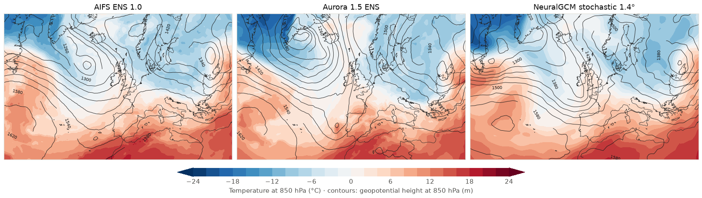
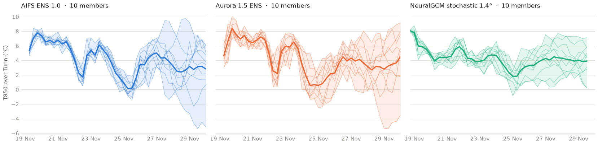
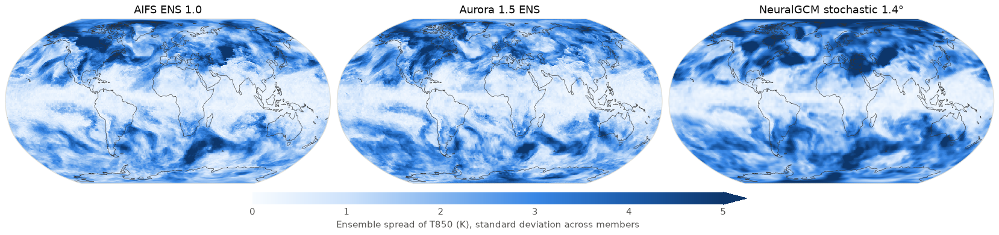

<div align="center">

# AIUQ

**AI weather and climate models for Uncertainty Quantification, run as Autosubmit workflows**

[](https://github.com/JGrassi97/AIUQ/releases/latest)
[](https://aiuq.readthedocs.io)
[](LICENSE)
[](https://github.com/JGrassi97/AIUQ/commits/main)
<br>
[](https://autosubmit.readthedocs.io)
[](https://apptainer.org)
[](https://aiuq.readthedocs.io/en/latest/models.html)
[](#forecasting-from-the-latest-ecmwf-analysis)

<picture>
  <source media="(prefers-color-scheme: dark)" srcset="docs/images/forecast_maps_dark.png">
  
</picture>

<sub>Three AI models started from the ECMWF analysis of 19 November 2026 (NeuralGCM: 18 UTC on 18 November), valid at
00 UTC on 24 November: temperature (shading) and geopotential height (contours) at 850 hPa, ensemble member 1.
Experiments a00v, a00w and a00x.</sub>

</div>

> **v1.0.0**: first stable release ([changelog](CHANGELOG.md), [documentation](https://aiuq.readthedocs.io)).
> - Three model families: NeuralGCM, AIFS (single and ensemble) and Microsoft Aurora (1.0 and 1.5, including the 1.5 ensemble).
> - Three sources of initial conditions: ERA5, EERIE and the latest ECMWF analysis (`ICS: ecmwf-an`, ECMWF Open Data, no credentials required).
> - Hindcasts and AMIP simulations, with forcings prescribed in the [AIMIP project](https://zenodo.org/records/17065758) and from [ESA-CCI-v3.0](https://climate.esa.int/en/projects/sea-surface-temperature/).
> - Model outputs are streamed to disk, so memory no longer grows with forecast length.
> - A web dashboard to monitor experiments and to create and launch new ones ([`tools/dashboard`](tools/dashboard)).


AIUQ (Artificial Intelligence weather forecasting models for Uncertainty Quantification) is a framework for running AI-based weather and climate models using Autosubmit. It is designed to efficiently handle different combinations of initial conditions (ICs) and models. The integration of multiple fallback methods allows the use of different sets of initial conditions, even when they do not fully match the AI model requirements.


The framework supports both deterministic and stochastic models. Deterministic models always produce the same results when initialized with the same ICs, whereas stochastic models are able to generate an ensemble of realizations starting from identical ICs. For this reason, AIUQ also implements several classes of methods to perturb the ICs (still under development), allowing the generation of ensembles of realizations even from deterministic models.

<!-- support-matrix:start (generated by docs/generate_table.py, do not edit) -->
<table><tr><td>
<b>The current implementation supports the following ICs / AI models:</b><br><br>
<table>
<tr>
<th>Model</th>
<th>Supported modes</th>
<th>Checkpoint</th>
<th>ERA5</th>
<th>EERIE (AMIP)</th>
<th>ECMWF analysis</th>
<th>EC-Earth3 (CMIP6)</th>
</tr>
<tr>
<td rowspan="6"><b>NeuralGCM</b></td>
<td rowspan="6">amip/hindcast</td>
<td><a href="https://neuralgcm.readthedocs.io/en/latest/checkpoints.html">stochastic_1_4_deg.pkl</a></td>
<td align="center">✅</td>
<td align="center">✅</td>
<td align="center">✅</td>
<td align="center">✅</td>
</tr>
<tr>
<td><a href="https://neuralgcm.readthedocs.io/en/latest/checkpoints.html">stochastic_precip_2_8_deg.pkl</a></td>
<td align="center">✅</td>
<td align="center">✅</td>
<td align="center">✅</td>
<td align="center">✅</td>
</tr>
<tr>
<td><a href="https://neuralgcm.readthedocs.io/en/latest/checkpoints.html">stochastic_evap_2_8_deg.pkl</a></td>
<td align="center">✅</td>
<td align="center">✅</td>
<td align="center">✅</td>
<td align="center">✅</td>
</tr>
<tr>
<td><a href="https://neuralgcm.readthedocs.io/en/latest/checkpoints.html">deterministic_0_7_deg.pkl</a></td>
<td align="center">✅</td>
<td align="center">✅</td>
<td align="center">✅</td>
<td align="center">⚠️</td>
</tr>
<tr>
<td><a href="https://neuralgcm.readthedocs.io/en/latest/checkpoints.html">deterministic_1_4_deg.pkl</a></td>
<td align="center">✅</td>
<td align="center">✅</td>
<td align="center">✅</td>
<td align="center">⚠️</td>
</tr>
<tr>
<td><a href="https://neuralgcm.readthedocs.io/en/latest/checkpoints.html">deterministic_2_8_deg.pkl</a></td>
<td align="center">✅</td>
<td align="center">✅</td>
<td align="center">✅</td>
<td align="center">⚠️</td>
</tr>
<tr>
<td rowspan="3"><b>AIFS</b></td>
<td rowspan="3">hindcast</td>
<td><a href="https://huggingface.co/ecmwf/aifs-single-1.1">aifs-single-mse-1.1.ckpt</a></td>
<td align="center">✅</td>
<td align="center">✅</td>
<td align="center">✅</td>
<td align="center">✅</td>
</tr>
<tr>
<td><a href="https://huggingface.co/ecmwf/aifs-ens-1.0">aifs-ens-crps-1.0.ckpt</a></td>
<td align="center">✅</td>
<td align="center">✅</td>
<td align="center">✅</td>
<td align="center">✅</td>
</tr>
<tr>
<td><a href="https://huggingface.co/ecmwf/aifs-ens-2.0">aifs-ens-crps-2.0.ckpt</a></td>
<td align="center">✅</td>
<td align="center">❌</td>
<td align="center">✅</td>
<td align="center">❌</td>
</tr>
<tr>
<td rowspan="4"><b>MS Aurora</b></td>
<td rowspan="4">hindcast</td>
<td><a href="https://microsoft.github.io/aurora/models.html">aurora-0.25-pretrained.ckpt</a></td>
<td align="center">✅</td>
<td align="center">✅</td>
<td align="center">✅</td>
<td align="center">✅</td>
</tr>
<tr>
<td><a href="https://microsoft.github.io/aurora/models.html">aurora-0.25-finetuned.ckpt</a></td>
<td align="center">✅</td>
<td align="center">✅</td>
<td align="center">✅</td>
<td align="center">✅</td>
</tr>
<tr>
<td><a href="https://microsoft.github.io/aurora/example_v1p5.html">aurora-0.25-v1.5.ckpt</a></td>
<td align="center">✅</td>
<td align="center">✅</td>
<td align="center">✅</td>
<td align="center">✅</td>
</tr>
<tr>
<td><a href="https://microsoft.github.io/aurora/models.html#aurora-1-5-ensemble-0-25">aurora-0.25-v1.5-ensemble.ckpt</a></td>
<td align="center">✅</td>
<td align="center">✅</td>
<td align="center">✅</td>
<td align="center">✅</td>
</tr>
<tr>
<td rowspan="2"><b>WeatherNext</b></td>
<td rowspan="2">hindcast</td>
<td><a href="https://github.com/google-deepmind/weathernext">WeatherNext2_2025</a></td>
<td align="center">⚠️</td>
<td align="center">⚠️</td>
<td align="center">⚠️</td>
<td align="center">⚠️</td>
</tr>
<tr>
<td><a href="https://github.com/google-deepmind/weathernext">WeatherNextCyclones_Mini_2024</a></td>
<td align="center">⚠️</td>
<td align="center">⚠️</td>
<td align="center">⚠️</td>
<td align="center">⚠️</td>
</tr>
<tr>
<td rowspan="1"><b>ACE</b></td>
<td rowspan="1">amip (planned)</td>
<td><a href="https://huggingface.co/allenai/ACE2-ERA5">ACE2-ERA5</a></td>
<td align="center">❌</td>
<td align="center">❌</td>
<td align="center">❌</td>
<td align="center">❌</td>
</tr>
</table>
</td>
<td style="padding-left:20px; vertical-align:top;">
<b> </b><br><br>
<b> </b><br><br>
✅ available<br>
⚠️ work in progress<br>
❌ not implemented<br>
</td></tr></table>
<!-- support-matrix:end -->


## Ensembles from AI models

Each experiment runs any number of members, so the same initial state becomes a distribution of futures. The
figures below come from the three 10-member forecasts above (ECMWF analysis, 10 days, outputs at 0.25° every 6 h).

<picture>
  <source media="(prefers-color-scheme: dark)" srcset="docs/images/ensemble_plume_dark.png">
  
</picture>

<sub>Temperature at 850 hPa over Turin (45.07° N, 7.69° E): every member (thin lines), ensemble mean (thick line) and
member range (band).</sub>

<picture>
  <source media="(prefers-color-scheme: dark)" srcset="docs/images/ensemble_spread_dark.png">
  
</picture>

<sub>Ensemble spread (standard deviation across the 10 members) of 850 hPa temperature, valid at 00 UTC on
27 November 2026.</sub>

## Quickstart

### Installation

To run the framework you need
- Autosubmit on the machine that drives the experiments. Please refer to the [official documentation](https://autosubmit.readthedocs.io/en/master/) to install it.
- An HPC platform with Slurm, Singularity/Apptainer and GPUs for the inference jobs (configured in `conf/platforms.yml`; MareNostrum 5 and FELIPE are included).
- The supporting files on the HPC, in one folder whose path is given as `PATHS.SUPPORT_FOLDER`:

```
<SUPPORT_FOLDER>/
├── models/
│   ├── neuralgcm/       # *.pkl checkpoints
│   ├── aifs/            # *.ckpt checkpoints
│   ├── ms-aurora/       # *.ckpt checkpoints
│   └── weathernext/     # one folder per checkpoint, with the seeds as model1.npz, model2.npz, ...
├── sif/                 # Singularity images: image_era.sif, image_eerie.sif (also used by ecmwf-an),
│                        #   image_neuralgcm.sif, image_anemoi.sif (AIFS 1.x), image_anemoi-2.sif (AIFS 2.x),
│                        #   image_aurora.sif, image_weathernext.sif
├── static/              # AIUQ-static.nc (1st-level fallback: orography, land-sea mask, soil type, ...)
│                        #   aurora-0.25-static.pickle, aurora-0.25-v1.5-static.pickle
├── climatology/         # AIUQ-climatology.nc (2nd-level fallback)
├── amip-forcings/       # <FORCING_VERSION>/ forcings, AMIP runs only
└── aifs_grid.txt        # AIFS N320 grid description, used by the AIFS POSTPROCESS job
```

Checkpoints are resolved as `<SUPPORT_FOLDER>/models/<MODEL.NAME>/<MODEL.CHECKPOINT_NAME>`, so the file names must match
the support matrix above. [`remote_set/get_models.txt`](remote_set/get_models.txt) downloads every checkpoint and the
Aurora static files, [`remote_set/image_aurora.def`](remote_set/image_aurora.def) is the recipe of the Aurora image and
[`remote_set/image_anemoi-2.def`](remote_set/image_anemoi-2.def) the one of the anemoi image for the AIFS 2.x checkpoints
(anemoi-inference 0.8, torch 2.7, FlashAttention; the 1.x checkpoints keep `image_anemoi.sif`).
The AIFS POSTPROCESS job also needs [CDO](https://code.mpimet.mpg.de/projects/cdo) on the HPC (loaded as a module on
MareNostrum 5, from the system on FELIPE).

### Execution

#### Create the experiment
```
autosubmit expid \
  --description "AIUQ" \
  --HPC MareNostrum5ACC \
  --minimal_configuration \
  --git_as_conf conf/bootstrap/ \
  --git_repo https://github.com/JGrassi97/AIUQ.git \
  --git_branch main
```

Use `--HPC FELIPE` on FELIPE. The platform names are defined in [`conf/platforms.yml`](conf/platforms.yml). Nothing in the
repository is tied to a user: your HPC user, support folder and output store come from the experiment's `main.yml`
below. To run on another machine, see
[Running AIUQ at a new site](https://aiuq.readthedocs.io/en/latest/configuration.html#running-aiuq-at-a-new-site).

#### Run the experiment

Create the file <EXPID>/conf/main.yml. 

```
# <EXPID>/conf/main.yml

MODEL:
  # Main settings
  NAME: aifs                                        # aifs / neuralgcm / ms-aurora
  CHECKPOINT_NAME: aifs-single-mse-1.1.ckpt         # checkpoint name as written in the table above
  ICS: eerie                                        # eerie / era5 / ecmwf-an / ec-earth3

EXPERIMENT:
  RUN_TYPE: "hindcast" # hindcast / amip
  MEMBERS: "1 2"
  CHUNKSIZEUNIT: day
  DATELIST: 20100101
  CHUNKSIZE: 2
  NUMCHUNKS: 1
  CALENDAR: standard
  OUT_VARS:       
    - t                                                         # Make sure to use the name provided in the standard
  OUT_FREQ: daily                                               # original / daily
  OUT_RES: "1"                                                  # original / 0.25 / 0.5 / 1 / 1.5 / 2
  OUT_LEVS: [1000, 850, 700, 500, 250, 100, 50, 10]             # List of values in hPa or 'original' - 
  # Here reported from https://github.com/PCMDI/cmip6-cmor-tables/blob/087fe45d21c082e28723e0f930e4266abe91b853/Tables/CMIP6_coordinate.json#L1640

  FORCING_VERSION: ESA-CCI-v3.0   # ESA-CCI-v3.0/AIMIP

PATHS:
  SUPPORT_FOLDER: /path/to/AIUQ                     # the AIUQ support folder on the HPC
  SIF_FOLDER: "%PATHS.SUPPORT_FOLDER%/sif"

PLATFORM:
  NAME: MARENOSTRUM5  # FELIPE / MARENOSTRUM5
  USER_CODE: your_hpc_user                          # your user on the HPC
```

Then run `autosubmit create <EXPID>` and `autosubmit run <EXPID>`.

Note that some ICs require credentials to be retrieved:
- ERA5  -> Google Cloud Store - No credentials required
- EERIE -> MARS - ECMWF Web API credentials required ([read here](https://www.ecmwf.int/en/computing/software/ecmwf-web-api))
- ECMWF analysis (`ecmwf-an`) -> [ECMWF Open Data](https://www.ecmwf.int/en/forecasts/datasets/open-data) - No credentials required
- EC-Earth3 CMIP6 (`ec-earth3`) -> [ESGF](https://esgf.llnl.gov/) over OPeNDAP - No credentials required

#### Output store

On FELIPE the outputs leave the HPC scratch while the experiment runs, so the scratch holds only the start dates being
simulated:

- `STORE` (one per start date, Autosubmit host, `templates/store.sh`) moves the outputs of its start date into the
  output store as soon as every `SIM` of that date (and, for AIFS, every `POSTPROCESS` and `CLEAN`) has completed, and
  removes the date's initial conditions. It moves exactly the files the jobs of that date wrote: each job lists them in
  `<HPCROOTDIR>/store_pending/<SDATE>/<job>.txt`.
- `PREPARE_ICS` of a start date waits until every `SIM` two start dates earlier has completed. Initial conditions are
  prepared at most two dates ahead, and Slurm holds at most about two start dates of `SIM` jobs (members × chunks each)
  instead of the whole experiment. For a stricter limit add `JOBS: {PREPARE_ICS: {DEPENDENCIES: SIM-1}}` to `main.yml`.
- `ARCHIVE` (once, last) moves what is left: restart checkpoints, logs and code.

Autosubmit can reuse an expid after `autosubmit delete`, so each experiment gets its own folder:

```
<OUTPUT_STORE.DIR>/<expid>_<YYYYmmddTHHMMSS>/
    outputs/<var>/<member>/*.nc   outputs (restart checkpoints in outputs/checkpoints)
    LOG_<expid>/                  every job log, configuration, COMPLETED flag and STAT file
    runscripts/ conf/ lib/        the code that ran
    autosubmit/                   the experiment's Autosubmit configuration (main.yml, ...)
    archive.json                  source, time, files, bytes, git commit of the project, stored start dates
```

The folder has the layout of the experiment folder on the HPC, so the Monitor, Compare, Weather and AIUQ-store read it
directly. The jobs write `~/autosubmit/<expid>/OUTPUT_STORE.json` on the Autosubmit host, which the Monitor and the
`aiuq` skill follow once it says `done`; while it says `partial` (some start dates stored, the experiment still
running) they keep reading the HPC folder, which then holds only the dates not stored yet. A store folder without
`LOG_<expid>/` is such a running experiment, and Compare and Weather skip it. The HPC folder (`<HPCROOTDIR>`, initial conditions included) is removed only after a second
rsync pass finds nothing left to copy. The default store is `/data/users/<PLATFORM.USER_CODE>/AIUQ-outputs` (`conf/general.yml`);
choose another folder per experiment in `main.yml` or in the Launcher's "Output store" field:

```
OUTPUT_STORE:
  DIR: /data/users/<user>/AIUQ-outputs   # a folder on the Autosubmit host
  DELETE_SOURCE: true                    # false: copy only, keep the HPC folder
  ENABLED: true                          # false: everything stays on the HPC
```

`STORE` refuses to move anything while Slurm still has jobs of its start date, `ARCHIVE` while it has jobs of the
experiment; both copy, check with a second rsync pass and only then delete, and running them again is harmless.
Experiments created before 2026-11-19 have no `ARCHIVE` job, and those created before 2026-11-24 have no `STORE` jobs
(their `ARCHIVE` moves everything at the end).

#### Forecasting from the latest ECMWF analysis

With `ICS: ecmwf-an`, `PREPARE_ICS` takes the IFS HRES state at step 0 (the analysis, 0.25°) from ECMWF Open Data and
selects the newest cycle T for which both T-6h and T are published. Set `DATELIST` to today's date to start from the
latest analysis available when the job runs; a past date gives that day's 18 UTC analysis (Open Data archive, 0.25° from
February 2024). The selected cycle is stored in the `analysis_time` attribute of the ICs and sets the valid times of the
outputs.

Open Data does not publish every variable of the standard, so:
- `slt`, `lsm`, `sdor`, `slor`, `orog` come from the static file and `clwc`, `ciwc` from the ERA5 climatology;
- `sst` is the skin temperature over open sea (271.46 K under ice) and `ci` is 1 where the IFS ocean model has sea ice
  (a binary field that slightly overestimates the ice edge);
- levels 10-1000 hPa are interpolated in log-pressure, 1-7 hPa are extrapolated (temperature following the US Standard
  Atmosphere anchored at 10 hPa, hydrostatic geopotential, constant wind and humidity). Only NeuralGCM uses them.

Data: © ECMWF, [CC BY 4.0](https://creativecommons.org/licenses/by/4.0/).

#### Starting from an EC-Earth3 climate simulation

With `ICS: ec-earth3`, `PREPARE_ICS` reads the state of the EC-Earth3 CMIP6 simulations at `DATELIST` 00 and 06 UTC from
ESGF over OPeNDAP, transferring only the time steps it needs. Dates up to 2014 use `historical`, later dates the
scenario of `conf/cards/ics/ec-earth3_card.yml` (`ssp585`); member `r4i1p1f1` is the only one with the 6-hourly
upper-air fields. Choose another scenario or member per experiment:

```
MODEL:
  ICS: ec-earth3
  ICS_EXPERIMENT: ssp245     # historical, ssp119, ssp126, ssp245, ssp370, ssp585
  ICS_MEMBER: r4i1p1f1
```

The ICs are a climate-model state: they follow the EC-Earth3 climate, not the observed weather of that date.
EC-Earth3 publishes 6-hourly upper-air fields on 7 levels only (925-50 hPa), so:
- upper-air profiles are the daily means on 19 levels (1000-1 hPa) plus the 6-hourly departure from them, spread
  between the 6-hourly levels in log-pressure, held below 925 hPa and tapered to zero above 50 hPa; in `historical`
  the humidity has no 6-hourly field and is the daily mean;
- daily and 6-hourly means (cloud cover, snow, soil moisture, sea ice, SST, 100 m wind, vertical velocity) are
  interpolated in time to 00/06 UTC;
- `sp`, `d2m`, `tcwv`, `tcw`, `skt`, `sot` and the low/medium/high cloud cover are derived (see the `derivation`
  attribute of each variable); `slt`, `lsm`, `sdor`, `slor`, `orog`, `clwc`, `ciwc` come from the static file and the
  ERA5 climatology. There are no ocean-wave fields, so AIFS ENS v2 cannot start from EC-Earth3.

Data: EC-Earth Consortium, CMIP6, [CC BY 4.0](https://creativecommons.org/licenses/by/4.0/).

## Dashboard

[`tools/dashboard`](tools/dashboard) is a web dashboard for AIUQ experiments, made of two apps:

- **Autosubmit Monitor** (read-only): job status grid and Gantt timeline, estimated time to finish, PREPARE_ICS/MARS
  progress, SLURM queue and GPU use, logs of running and failed jobs, and maps, point time series, area averages and
  ensemble diagnostics of the outputs.
- **AIUQ Launcher**: creates experiments (`autosubmit expid` + `conf/main.yml` + `autosubmit create`), starts and stops
  their runs, and deletes them. Every action asks for confirmation and is logged.

It runs on the Autosubmit host as a `systemd --user` service (`bash tools/dashboard/deploy/install.sh`) and listens on a
private Unix socket (`~/.aiuq-dashboard/dash.sock`), so only your user can reach it. Open it with an ssh tunnel:

```
ssh -N -L 8765:/home/<user>/.aiuq-dashboard/dash.sock <autosubmit-host>
```

and browse to <http://localhost:8765>. Installation, settings and data sources are described in
[`tools/dashboard/README.md`](tools/dashboard/README.md).

## Developer’s Guide

### Standard

The main challenge in developing and maintaining the framework is handling the different specifications required by each IC and AI model, such as naming conventions, grids, pressure levels, etc. Hardcoding every possible combination quickly leads to an unmanageable number of cases.

To address this issue, the framework adopts a standard convention called **AIUQ-st**:

- ICs are always saved, retrieved, and temporarily restored according to the AIUQ-st standard.
- AI models always perform inference starting from data formatted in the AIUQ-st standard.

Since this standard may evolve due to future developments or different user requirements, it is versioned. Each version is stored under `conf/AIUQ-st/<version>`; the templates select the current one (`STD_VERSION` in `templates/config.yml`, now `v100`) and the earlier versions (`v010`, `v000`) stay in the repository as reference.

**Note:** Developers are responsible for keeping the codebase as modular as possible in order to remain independent of any single AIUQ-st convention.

---

#### AIUQ-st v100

Below is a brief description of **AIUQ-st/v100**:

- **Storage format:** `.zarr`
- **Naming conventions:** [ECMWF Parameter database](https://codes.ecmwf.int/grib/param-db/?encoding=netcdf)
- **Coordinates:** latitude / longitude / time / level
- **Grid:** regular latitude–longitude grid with 0.25° × 0.25° resolution  
  - latitude range: −90° to 90° N  
  - longitude range: 0° to 360° E
- **Variable types:** `sfc` (single level), `pl` (pressure levels), `soil` (soil layers) and `wave` (ocean waves, sea points only, NaN over land).
- **Optional variables:** the eleven wave fields (`swh`, `mwd`, `mwp`, `cdww`, `wmb`, `h1012` … `h2530`), needed by AIFS ENS v2, are `optional: true`: an IC source that cannot provide them (EERIE) is still valid for the models that do not use them.

Compared with v010 (kept in `conf/AIUQ-st/v010` as reference), v100 only adds the wave fields; variables, units and pressure levels of v010 are unchanged.

- **Output-only variables:** `conf/AIUQ-st/v100/outputs.yml` defines the fields models write but initial conditions never provide (precipitation and other totals, radiation, cloud and wind diagnostics, mean rates such as `avg_tprate`). Each model card lists per checkpoint what it can write (`checkpoints` block); see the *Output variables* section of the documentation (`docs/source/models.rst`).

In practice, developers who aim to introduce a new initial condition (IC) must provide the code required to retrieve and store the ICs according to the AIUQ-st convention. They should also strive to keep the implementation modular in order to remain resilient to future changes in the standard.

To support this process, the framework provides a set of standard options, utility functions, and best practices. Before proceeding, developers are strongly encouraged to carefully read the relevant Wiki pages.
