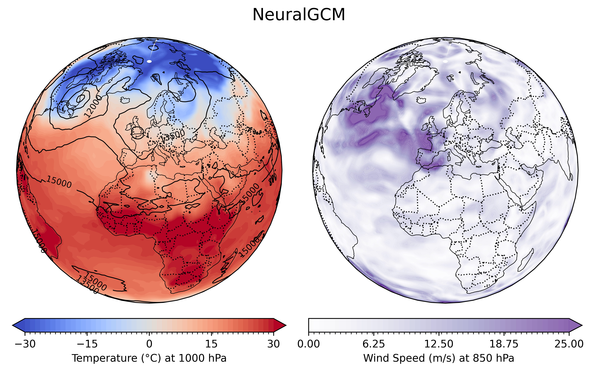
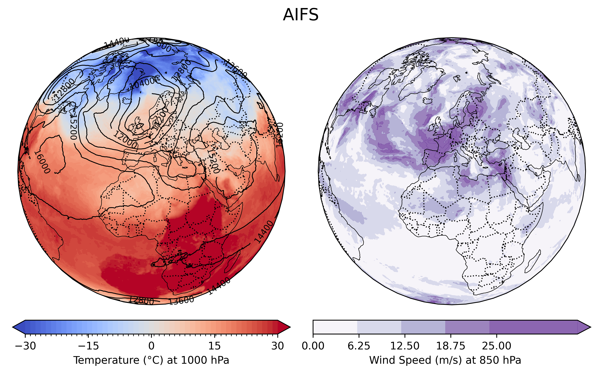

# AIUQ

> **v1.0.0**: first stable release ([changelog](CHANGELOG.md), [documentation](https://aiuq.readthedocs.io)).
> - Three model families: NeuralGCM, AIFS (single and ensemble) and Microsoft Aurora (1.0 and 1.5, including the 1.5 ensemble).
> - Three sources of initial conditions: ERA5, EERIE and the latest ECMWF analysis (`ICS: ecmwf-an`, ECMWF Open Data, no credentials required).
> - Hindcasts and AMIP simulations, with forcings prescribed in the [AIMIP project](https://zenodo.org/records/17065758) and from [ESA-CCI-v3.0](https://climate.esa.int/en/projects/sea-surface-temperature/).
> - Model outputs are streamed to disk, so memory no longer grows with forecast length.
> - A web dashboard to monitor experiments and to create and launch new ones ([`tools/dashboard`](tools/dashboard)).


AIUQ (Artificial Intelligence weather forecasting models for Uncertainty Quantification) is a framework for running AI-based weather and climate models using Autosubmit. It is designed to efficiently handle different combinations of initial conditions (ICs) and models. The integration of multiple fallback methods allows the use of different sets of initial conditions, even when they do not fully match the AI model requirements.


The framework supports both deterministic and stochastic models. Deterministic models always produce the same results when initialized with the same ICs, whereas stochastic models are able to generate an ensemble of realizations starting from identical ICs. For this reason, AIUQ also implements several classes of methods to perturb the ICs (still under development), allowing the generation of ensembles of realizations even from deterministic models.

<!-- support-matrix:start (generated by docs/generate_table.py, do not edit) -->
<table><tr><td>
<b>The current implementation supports the following ICs / AI models:</b><br><br>
<table>
<tr>
<th>Model</th>
<th>Supported modes</th>
<th>Checkpoint</th>
<th>ERA5</th>
<th>EERIE (AMIP)</th>
<th>ECMWF analysis</th>
</tr>
<tr>
<td rowspan="6"><b>NeuralGCM</b></td>
<td rowspan="6">amip/hindcast</td>
<td><a href="https://neuralgcm.readthedocs.io/en/latest/checkpoints.html">stochastic_1_4_deg.pkl</a></td>
<td align="center">✅</td>
<td align="center">✅</td>
<td align="center">✅</td>
</tr>
<tr>
<td><a href="https://neuralgcm.readthedocs.io/en/latest/checkpoints.html">stochastic_precip_2_8_deg.pkl</a></td>
<td align="center">✅</td>
<td align="center">✅</td>
<td align="center">✅</td>
</tr>
<tr>
<td><a href="https://neuralgcm.readthedocs.io/en/latest/checkpoints.html">stochastic_evap_2_8_deg.pkl</a></td>
<td align="center">✅</td>
<td align="center">✅</td>
<td align="center">✅</td>
</tr>
<tr>
<td><a href="https://neuralgcm.readthedocs.io/en/latest/checkpoints.html">deterministic_0_7_deg.pkl</a></td>
<td align="center">✅</td>
<td align="center">✅</td>
<td align="center">✅</td>
</tr>
<tr>
<td><a href="https://neuralgcm.readthedocs.io/en/latest/checkpoints.html">deterministic_1_4_deg.pkl</a></td>
<td align="center">✅</td>
<td align="center">✅</td>
<td align="center">✅</td>
</tr>
<tr>
<td><a href="https://neuralgcm.readthedocs.io/en/latest/checkpoints.html">deterministic_2_8_deg.pkl</a></td>
<td align="center">✅</td>
<td align="center">✅</td>
<td align="center">✅</td>
</tr>
<tr>
<td rowspan="2"><b>AIFS</b></td>
<td rowspan="2">hindcast</td>
<td><a href="https://huggingface.co/ecmwf/aifs-single-1.1">aifs-single-mse-1.1.ckpt</a></td>
<td align="center">✅</td>
<td align="center">⚠️</td>
<td align="center">✅</td>
</tr>
<tr>
<td><a href="https://huggingface.co/ecmwf/aifs-ens-1.0">aifs-ens-crps-1.0.ckpt</a></td>
<td align="center">✅</td>
<td align="center">✅</td>
<td align="center">✅</td>
</tr>
<tr>
<td rowspan="4"><b>MS Aurora</b></td>
<td rowspan="4">hindcast</td>
<td><a href="https://microsoft.github.io/aurora/models.html">aurora-0.25-pretrained.ckpt</a></td>
<td align="center">✅</td>
<td align="center">⚠️</td>
<td align="center">✅</td>
</tr>
<tr>
<td><a href="https://microsoft.github.io/aurora/models.html">aurora-0.25-finetuned.ckpt</a></td>
<td align="center">✅</td>
<td align="center">⚠️</td>
<td align="center">✅</td>
</tr>
<tr>
<td><a href="https://microsoft.github.io/aurora/example_v1p5.html">aurora-0.25-v1.5.ckpt</a></td>
<td align="center">✅</td>
<td align="center">⚠️</td>
<td align="center">✅</td>
</tr>
<tr>
<td><a href="https://microsoft.github.io/aurora/models.html#aurora-1-5-ensemble-0-25">aurora-0.25-v1.5-ensemble.ckpt</a></td>
<td align="center">✅</td>
<td align="center">⚠️</td>
<td align="center">✅</td>
</tr>
<tr>
<td rowspan="1"><b>ACE</b></td>
<td rowspan="1">amip (planned)</td>
<td><a href="https://huggingface.co/allenai/ACE2-ERA5">ACE2-ERA5</a></td>
<td align="center">❌</td>
<td align="center">❌</td>
<td align="center">❌</td>
</tr>
</table>
</td>
<td style="padding-left:20px; vertical-align:top;">
<b> </b><br><br>
<b> </b><br><br>
✅ available<br>
⚠️ work in progress<br>
❌ not implemented<br>
</td></tr></table>
<!-- support-matrix:end -->


<p align="center">
  
  
  <br>
  <em>
  NeuralGCM (resolution 1.4°) and AIFS-ens (resolution 0.25°) forecasts for January 21st, 1988.
  Both simulations are initialized on January 1st, 1988, using ERA5 reanalysis data.
  </em>
</p>

## Quickstart

### Installation

To run the framework you need
- Autosubmit on the machine that drives the experiments. Please refer to the [official documentation](https://autosubmit.readthedocs.io/en/master/) to install it.
- An HPC platform with Slurm, Singularity/Apptainer and GPUs for the inference jobs (configured in `conf/platforms.yml`; MareNostrum 5 and FELIPE are included).
- The supporting files on the HPC, in one folder whose path is given as `PATHS.SUPPORT_FOLDER`:

```
<SUPPORT_FOLDER>/
├── models/
│   ├── neuralgcm/       # *.pkl checkpoints
│   ├── aifs/            # *.ckpt checkpoints
│   └── ms-aurora/       # *.ckpt checkpoints
├── sif/                 # Singularity images: image_era.sif, image_eerie.sif (also used by ecmwf-an),
│                        #   image_neuralgcm.sif, image_anemoi.sif (AIFS), image_aurora.sif
├── static/              # AIUQ-static.nc (1st-level fallback: orography, land-sea mask, soil type, ...)
│                        #   aurora-0.25-static.pickle, aurora-0.25-v1.5-static.pickle
├── climatology/         # AIUQ-climatology.nc (2nd-level fallback)
├── amip-forcings/       # <FORCING_VERSION>/ forcings, AMIP runs only
└── aifs_grid.txt        # AIFS N320 grid description, used by the AIFS POSTPROCESS job
```

Checkpoints are resolved as `<SUPPORT_FOLDER>/models/<MODEL.NAME>/<MODEL.CHECKPOINT_NAME>`, so the file names must match
the support matrix above. [`remote_set/get_models.txt`](remote_set/get_models.txt) downloads every checkpoint and the
Aurora static files, and [`remote_set/image_aurora.def`](remote_set/image_aurora.def) is the recipe of the Aurora image.
The AIFS POSTPROCESS job also needs [CDO](https://code.mpimet.mpg.de/projects/cdo) on the HPC (loaded as a module on
MareNostrum 5, from the system on FELIPE).

### Execution

#### Create the experiment
```
autosubmit expid \
  --description "AIUQ" \
  --HPC MareNostrum5ACC \
  --minimal_configuration \
  --git_as_conf conf/bootstrap/ \
  --git_repo https://github.com/JGrassi97/AIUQ.git \
  --git_branch main
```

Use `--HPC FELIPE` on FELIPE. The platform names are defined in [`conf/platforms.yml`](conf/platforms.yml).

#### Run the experiment

Create the file <EXPID>/conf/main.yml. 

```
# <EXPID>/conf/main.yml

MODEL:
  # Main settings
  NAME: aifs                                        # aifs / neuralgcm / ms-aurora
  CHECKPOINT_NAME: aifs-single-mse-1.1.ckpt         # checkpoint name as written in the table above
  ICS: eerie                                        # eerie / era5 / ecmwf-an

EXPERIMENT:
  RUN_TYPE: "hindcast" # hindcast / amip
  MEMBERS: "1 2"
  CHUNKSIZEUNIT: day
  DATELIST: 20100101
  CHUNKSIZE: 2
  NUMCHUNKS: 1
  CALENDAR: standard
  OUT_VARS:       
    - t                                                         # Make sure to use the name provided in the standard
  OUT_FREQ: daily                                               # original / daily
  OUT_RES: "1"                                                  # original / 0.25 / 0.5 / 1 / 1.5 / 2
  OUT_LEVS: [1000, 850, 700, 500, 250, 100, 50, 10]             # List of values in hPa or 'original' - 
  # Here reported from https://github.com/PCMDI/cmip6-cmor-tables/blob/087fe45d21c082e28723e0f930e4266abe91b853/Tables/CMIP6_coordinate.json#L1640

  FORCING_VERSION: ESA-CCI-v3.0   # ESA-CCI-v3.0/AIMIP

PATHS:
  SUPPORT_FOLDER: /gpfs/scratch/ehpc536/AIUQ
  SIF_FOLDER: "%PATHS.SUPPORT_FOLDER%/sif"

PLATFORM:
  NAME: MARENOSTRUM5  # FELIPE / MARENOSTRUM5
  USER_CODE: #write your HPC user here
```

Then run `autosubmit create <EXPID>` and `autosubmit run <EXPID>`.

Note that some ICs require credentials to be retrieved:
- ERA5  -> Google Cloud Store - No credentials required
- EERIE -> MARS - ECMWF Web API credentials required ([read here](https://www.ecmwf.int/en/computing/software/ecmwf-web-api))
- ECMWF analysis (`ecmwf-an`) -> [ECMWF Open Data](https://www.ecmwf.int/en/forecasts/datasets/open-data) - No credentials required

#### Forecasting from the latest ECMWF analysis

With `ICS: ecmwf-an`, `PREPARE_ICS` takes the IFS HRES state at step 0 (the analysis, 0.25°) from ECMWF Open Data and
selects the newest cycle T for which both T-6h and T are published. Set `DATELIST` to today's date to start from the
latest analysis available when the job runs; a past date gives that day's 18 UTC analysis (Open Data archive, 0.25° from
February 2024). The selected cycle is stored in the `analysis_time` attribute of the ICs and sets the valid times of the
outputs.

Open Data does not publish every variable of the standard, so:
- `slt`, `lsm`, `sdor`, `slor`, `orog` come from the static file and `clwc`, `ciwc` from the ERA5 climatology;
- `sst` is the skin temperature over open sea (271.46 K under ice) and `ci` is 1 where the IFS ocean model has sea ice
  (a binary field that slightly overestimates the ice edge);
- levels 10-1000 hPa are interpolated in log-pressure, 1-7 hPa are extrapolated (temperature following the US Standard
  Atmosphere anchored at 10 hPa, hydrostatic geopotential, constant wind and humidity). Only NeuralGCM uses them.

Data: © ECMWF, [CC BY 4.0](https://creativecommons.org/licenses/by/4.0/).

## Dashboard

[`tools/dashboard`](tools/dashboard) is a web dashboard for AIUQ experiments, made of two apps:

- **Autosubmit Monitor** (read-only): job status grid and Gantt timeline, estimated time to finish, PREPARE_ICS/MARS
  progress, SLURM queue and GPU use, logs of running and failed jobs, and maps, point time series, area averages and
  ensemble diagnostics of the outputs.
- **AIUQ Launcher**: creates experiments (`autosubmit expid` + `conf/main.yml` + `autosubmit create`), starts and stops
  their runs, and deletes them. Every action asks for confirmation and is logged.

It runs on the Autosubmit host as a `systemd --user` service (`bash tools/dashboard/deploy/install.sh`) and listens on a
private Unix socket (`~/.aiuq-dashboard/dash.sock`), so only your user can reach it. Open it with an ssh tunnel:

```
ssh -N -L 8765:/home/<user>/.aiuq-dashboard/dash.sock <autosubmit-host>
```

and browse to <http://localhost:8765>. Installation, settings and data sources are described in
[`tools/dashboard/README.md`](tools/dashboard/README.md).

## Developer’s Guide

### Standard

The main challenge in developing and maintaining the framework is handling the different specifications required by each IC and AI model, such as naming conventions, grids, pressure levels, etc. Hardcoding every possible combination quickly leads to an unmanageable number of cases.

To address this issue, the framework adopts a standard convention called **AIUQ-st**:

- ICs are always saved, retrieved, and temporarily restored according to the AIUQ-st standard.
- AI models always perform inference starting from data formatted in the AIUQ-st standard.

Since this standard may evolve due to future developments or different user requirements, it is versioned. Each version is stored under `docs/AIUQ-st/version`.

**Note:** Developers are responsible for keeping the codebase as modular as possible in order to remain independent of any single AIUQ-st convention.

---

#### AIUQ-st v010

Below is a brief description of **AIUQ-st/v010**:

- **Storage format:** `.zarr`
- **Naming conventions:** [ECMWF Parameter database](https://codes.ecmwf.int/grib/param-db/?encoding=netcdf)
- **Coordinates:** latitude / longitude / time / level
- **Grid:** regular latitude–longitude grid with 0.25° × 0.25° resolution  
  - latitude range: −90° to 90° N  
  - longitude range: 0° to 360° E

In practice, developers who aim to introduce a new initial condition (IC) must provide the code required to retrieve and store the ICs according to the AIUQ-st convention. They should also strive to keep the implementation modular in order to remain resilient to future changes in the standard.

To support this process, the framework provides a set of standard options, utility functions, and best practices. Before proceeding, developers are strongly encouraged to carefully read the relevant Wiki pages.
